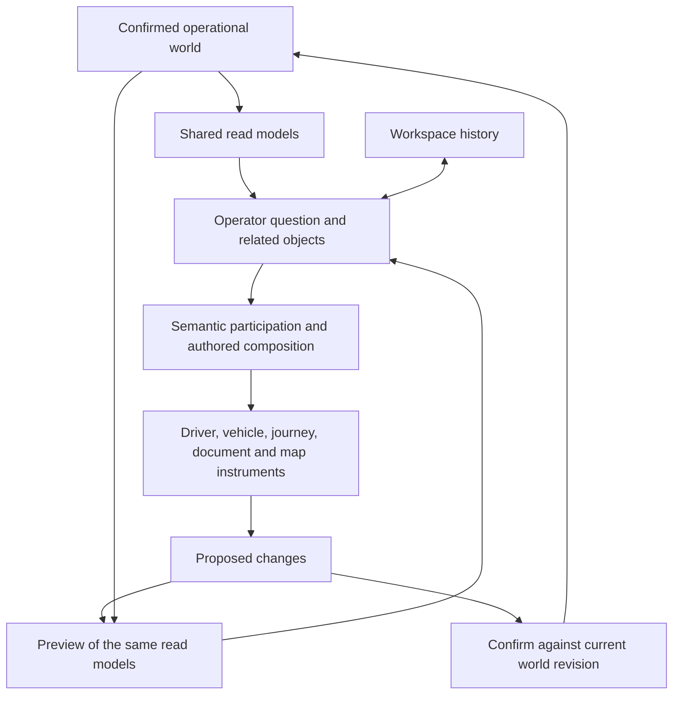

# FleetOS — page morphing analysis and reengineering direction

8 October 2026. Scope: `src/dev/fleetos-environment`, the real environment with the small sidebar. The office workspace was an experiment and is excluded from the diagnosis. This review analyzes the current working tree, which contains substantial existing uncommitted work. No frontend implementation was changed for this review.

Implementation follow-up: after this review, the user authorized the first persistent scene slice. See [the implementation report](</C:/Users/manue/OneDrive/Ambiente de Trabalho/fleet-tracker/docs/fleetos-page-morphing-implementation.md>). The probe scripts and named browser captures have since been refreshed against that implementation; the failure descriptions below record the original diagnosis, while the current evidence files show the fixes.

**The user's intended behavior**

The central requirement is how the overall page behaves: clicking the small menu should morph the existing screen. Existing content moves, grows, compresses, combines, and changes its representation as the requested perspective enters. That transformation is the intended sense of a living environment. The office workspace is a separate test and is not the target.

The primary reengineering task is the scene renderer and its transition behavior. Operational state findings later in this report support continuity, but they do not replace this visual and interaction objective.

**My assessment**

The intended product is already visible in this lab. It has a compact rail, operational instruments, relationships between objects, a persistent map, staged edits, consequence previews, and captured return history. These are valuable foundations for an environment in which an operator can work through a situation without repeatedly reconstructing context.

The main deviation is within the environment itself: its growing library of entity compositions is becoming a collection of destination views. Region geometry animates, but major content subtrees are conditionally replaced. The selected layout changes first, and an entrance animation or a ghost of a label helps bridge the replacement. This can feel like changing screens inside an animated shell.

A convincing next version needs the composition itself to be the interaction. The operator should see how the current scene becomes the next one. Stable object identity and trustworthy memory support that behavior. The priority is a coordinated transformation of the existing scene, rather than adding another set of destination layouts.

**Where the current renderer breaks the morph**

The root workspace and map already persist. The gap is below that shell:

- In the resource zone, conditional rendering selects `DriversRoster`, `FleetRoster`, `DriverInstrument`, `TruckInstrument`, or a fact column. Switching the main perspective replaces the large instrument subtree while the outer rectangle changes size.
- Job compositions use four persistent zone hosts. Entity compositions introduce a separate `layout.regions` render branch and suppress the zone children. Crossing those branches changes the render tree itself. The new regions do not inherently inherit the departing regions' rendered geometry.
- Entity regions preserve a region id where the recipe provides the same id, which is useful. Their representation component can still change. New content receives `fx-region-in`, a fade with a small upward movement and scale.
- `playContinuity` clones selected `[data-object]` elements and moves those ghosts between locations. It generally carries identities or references, not the entire day axis, technical drawing, journey, or dossier. It cannot by itself turn one information structure into another.

Source: [instrument switching and region rendering](</C:/Users/manue/OneDrive/Ambiente de Trabalho/fleet-tracker/src/dev/fleetos-environment/GuidedEnvironment.tsx:762>), [entity entrance animation](</C:/Users/manue/OneDrive/Ambiente de Trabalho/fleet-tracker/src/dev/fleetos-environment/fx/entity.css:22>), [continuity implementation](</C:/Users/manue/OneDrive/Ambiente de Trabalho/fleet-tracker/src/dev/fleetos-environment/fx/continuity.ts:1>).

This is why an application can remain at one URL and still feel like it opens another screen. The visible composition must retain recognizable structure through the transition, not just the root DOM node.

**The page behavior to build**

| Operator action | Transformation of the existing page |
|---|---|
| Add Truck while examining a Driver | The same driver remains recognizable; the day compresses to its relevant interval, the truck grows into available space, and shared transport facts connect them. |
| Bring Restrictions forward | Existing journey and vehicle facts reorganize around the selected restriction; the relevant segment and deciding physical fact become prominent. |
| Bring Documents forward | The document grows into a working surface; geography recedes where unnecessary, and related people, vehicle, and transport remain as compact context. |
| Request the map | The existing map region expands and reframes while the current instrument compresses into its spatial form. |
| Remove a lens | Its contribution contracts or withdraws; the remaining scene recovers the space it occupied. |
| Press Esc | The captured composition returns through the same objects and geometry, preserving working context. |

Each menu click should initiate one coordinated scene transformation. There can be a different final composition for each operational question. The continuity between those compositions is the product behavior that needs reengineering.

**The presentation architecture to change first**

1. **A unified scene model.** Normalize job zones and entity regions into one set of scene elements. Each element describes the operational object, its representation, role, target geometry, and visibility. The authored composition system still chooses the target arrangement.
2. **Stable scene hosts.** Match the previous scene and next scene by semantic identity. A driver element already on screen moves and changes form; a new related object enters from a meaningful origin in the current scene. Avoid using a domain name alone as the identity of every object in that domain.
3. **A transition plan.** Before changing the composition, capture actual rendered geometry and determine what persists, changes form, enters, and leaves. Keep departing elements long enough to contract or withdraw. New elements need an initial geometry connected to their source object or freed space.
4. **Instrument forms that transform.** A full driver day and its compact strip should share recognizable landmarks: identity, time axis, current position, and next limit. The truck's large and compact forms should preserve the same vehicle and marked part. Detail can be mounted or removed at appropriate stages; preserving every DOM node indefinitely is unnecessary.
5. **One motion coordinator.** Coordinate region movement, representation changes, entrances, exits, map resize, and camera motion. Retarget an interrupted transition from what is currently rendered. Continue to honor reduced motion and preserve the working context when motion is immediate.
6. **History of compositions.** Returning restores the previous scene description, selection, practical scroll, and camera. The return transition follows the same scene identities.

The existing map choreography, capture history, semantic groups, and authored recipes are assets for this refactor. Keep them. The main replacement is the split renderer and the reliance on whole-instrument replacement plus label ghosts as the continuity mechanism.

This does not require autonomous layout generation. Start with a few authored transitions whose content and intermediate geometry are deliberate. Generalize the scene identity and motion contracts after those transitions feel convincing.

**First visual slice and acceptance**

Start on selected J-4217 with Driver in front. Exercise Driver → add Truck → bring Restrictions forward → open map → Esc → remove Truck. Capture the start, intermediate frames, and finish of each transition, including a rapid second menu click before the first morph ends.

The acceptance criterion is visual: can the operator follow the same driver, truck, journey, and restriction as the page changes? The large instrument should not vanish at the beginning of the click and be replaced by a newly introduced destination view. Persistent objects move; supporting structures compress; new detail appears as space becomes available. Shared context stays legible throughout.

Measure stable object identity and interrupted transitions alongside the visual review. Existing settled screenshots and distinct-layout tests are useful, but they cannot prove that the page actually morphs between those states.

**Supporting continuity findings**

The rest of this report records state and identity problems found during the analysis. They matter because the visible objects being morphed must continue to represent the same work. They are supporting corrections to the presentation refactor, not a reason to postpone the page-behavior work until a complete backend redesign.

**What “living” should mean for this project**

An operator should be able to recognize the same transport, driver, vehicle, document, and restriction through multiple representations. A driver may appear on a day axis, beside a truck, or on a map; those representations should share identity, evidence, selection, and operational state.

Changes should produce understandable consequences. Recording a measurement should update the affected restriction verdict. Reassigning a driver should update assignment, qualification issues, future availability, and any document difference that depends on that assignment. Unknown or stale results should remain explicit while a calculation is unavailable.

The environment should remember the operator's place while those facts evolve. Returning from an inspection restores the previous question, selection, camera, and practical scroll position. It should preserve confirmed work. This is useful even with an entirely synthetic world and a fixed clock: live telemetry is not a prerequisite for proving the interaction model.

**The foundations to preserve**

| Foundation | Evidence in the current system | Value |
|---|---|---|
| Compact rail and anchor strip | `fx/Chrome.tsx` | Leaves most of the workspace for the operation and provides orientation. |
| Distinct operational instruments | Driver day, technical vehicle, journey axis, dossier, restriction logic | Each representation can express its own domain instead of forcing every domain into the same card. |
| Semantic participation | `compositionGrammar.ts` groups resources, journey, operation, and assurance | Supporting information can contribute without owning a separate large surface. |
| Persistent map | `EnvironmentMap.tsx`, ResizeObserver, camera choreography | Geographic context can change size and question without starting a new map session. |
| Explicit spatial questions | `spatialQuestions.ts` | Geography follows the operational question; the map can also be requested deliberately. |
| Preview and confirmation | `edits.ts`, `fx/model.ts`, `fx/impact.ts`, `PendingBar` | The operator can inspect consequences before committing a change. |
| Honest knowledge states | KNOWN / ASSUMED / UNKNOWN, sources, stale evidence | Gives the operator a basis for judging reliability. |
| Captured workspace history | `GuidedFrame`, `GuidedEnvironment.tsx` | Preserves actual state, geometry, camera, and scroll instead of reconstructing a generic previous view. |

The current explicit map request worked in the browser probe. Starting with Miguel plus the vehicle, opening the map produced `DRIVER_SPATIAL`, with the driver inspector retained. The map instance stayed the same across the seven captured scenes. Those capabilities should survive the reengineering.

**Reproduced failure 1: changing workspace can erase confirmed facts**

The browser probe established driver D-14 on J-4217, added the truck through the visible rail, staged the synthetic first-axle measurement `1.06`, and confirmed it through the DEV controller. The resulting state contained `overrides["axle:T-08"] = "1.06"`. The synthetic restriction query for RI-042 returned PASS.

Clicking the visible Drivers rail button to return to the collection produced an empty overrides object. The same query returned UNKNOWN again.

| Moment | Recorded axle fact | RI-042 query result |
|---|---|---|
| After confirmation | `1.06` | PASS |
| After returning to collection | Missing | UNKNOWN |

This is an observed state-loss defect in the DEV lab. The PASS value is the lab query's result for the seeded scenario, not an independent legal assessment.

The cause is the ownership boundary. `GuidedState` contains both working context and confirmed world facts. In `railChange`, turning off an entity's main lens constructs `initialGuidedState()`, which also initializes `overrides` to `{}`. Other empty-workspace transitions likewise return a fresh initial state. The history controller takes care to propagate confirmed overrides into previous frames, but that protects only those return paths; it does not protect navigation resets.

Source: [workspace state and rail transitions](</C:/Users/manue/OneDrive/Ambiente de Trabalho/fleet-tracker/src/dev/fleetos-environment/guidedWorkspace.ts:209>), [confirmed facts in the workspace model](</C:/Users/manue/OneDrive/Ambiente de Trabalho/fleet-tracker/src/dev/fleetos-environment/guidedWorkspace.ts:43>), [commit handling](</C:/Users/manue/OneDrive/Ambiente de Trabalho/fleet-tracker/src/dev/fleetos-environment/GuidedEnvironment.tsx:190>).

The durable correction is to give confirmed facts their own owner, separate from workspace context. A collection transition should change what the operator is looking at. An explicit DEV data reset may reset the synthetic world. Those need distinct commands.

**Reproduced failure 2: a map object can lose its transport identity**

The probe then established driver D-09 with J-4219, opened the map, and clicked its visible vehicle marker. The resulting anchor became Job J-4217.

The marker callback carries a generic resource identifier. `GuidedEnvironment.onSceneSelect` considers a job current only when `state.anchor.kind === "job"`. An entity anchor already carries its job, but that relationship is ignored there. The fallback branches enter the demonstration job J-4217.

Source: [map selection routing](</C:/Users/manue/OneDrive/Ambiente de Trabalho/fleet-tracker/src/dev/fleetos-environment/GuidedEnvironment.tsx:666>), [generic marker identity](</C:/Users/manue/OneDrive/Ambiente de Trabalho/fleet-tracker/src/dev/fleetos-environment/EnvironmentMap.tsx:445>).

This directly breaks the experience of following the same object. Every selectable map feature needs a typed entity reference and its relevant relationship context. A renderer should pass the object it actually represents. If the relationship is unknown, the environment should expose that uncertainty rather than substitute another transport.

**Architectural observation 1: the system has competing interaction grammars**

There are three broad contexts: operation/collection, a selected job, and a selected entity. Their rail behavior and follow behavior differ. The current rail makes a useful distinction between content on/off and main perspective, with a secondary control or Shift-click for main. Older `lens`, `toggle`, `expand`, and `open` actions remain alongside those actions.

For a job, changing main usually changes `lead`. For an entity, changing main can navigate to the related entity and replace the anchor. Following an entity clears facets and focus, resets spatial working mode, and installs selections for the new entity. Following the currently anchored object can return to its base composition and discard the other active layers. These are explicit code paths, not accidental browser navigation.

Some of those transitions may be desirable. The problem is that “change perspective,” “follow a related object,” “inspect a fact,” and “change the object of work” are not consistently separated. A small sidebar can therefore function like page navigation while the surrounding geometry animates.

Source: [main lens semantics](</C:/Users/manue/OneDrive/Ambiente de Trabalho/fleet-tracker/src/dev/fleetos-environment/guidedWorkspace.ts:201>), [entity transition](</C:/Users/manue/OneDrive/Ambiente de Trabalho/fleet-tracker/src/dev/fleetos-environment/guidedWorkspace.ts:320>), [entity translation](</C:/Users/manue/OneDrive/Ambiente de Trabalho/fleet-tracker/src/dev/fleetos-environment/guidedWorkspace.ts:737>).

The reengineered grammar should define those intents once. Inspecting a linked truck can bring its technical representation forward while retaining the transport and the question that motivated the inspection. Explicitly starting work on another object can change scope. Neither action needs a new permanent mode or an extra window system.

**Architectural observation 2: representation selection is partly driving the question**

`entityRecipes.ts` names meaningful operational questions, which is a strength. Its recipe selection nevertheless relies mainly on anchor kind and membership of active lenses. For a driver, Trucks chooses `DRIVER_AND_VEHICLE`; Trucks plus Restrictions chooses `DRIVER_VEHICLE_RESTRICTIONS`. In those recipes the dominant representation changes from driver day, to vehicle object, to journey axis.

That can be an effective composition. But the main rail lens still identifies the driver while the dominant visual region identifies the truck or journey. Anchor, main lens, operational question, and visual prominence are serving different roles; those roles need to be explicit in the design.

The recipe function also describes ordered layers, while its major decisions use `includes()` and fixed precedence. Ordered layer labels alone do not make selection depend on the operator's latest question.

Source: [recipe selection and question labels](</C:/Users/manue/OneDrive/Ambiente de Trabalho/fleet-tracker/src/dev/fleetos-environment/entityRecipes.ts:57>), [authored region roles](</C:/Users/manue/OneDrive/Ambiente de Trabalho/fleet-tracker/src/dev/fleetos-environment/entityComposition.ts:49>).

The next compositor should receive an explicit question and the evidence relevant to it. Authored recipes remain valuable as the representation vocabulary. Adding a lens should enrich that question or make another question available; it should not always imply a new dominant composition. A stable composition is sometimes the right response to a new fact.

**Architectural observation 3: the world does not yet update coherently everywhere**

The instruments often read `labWorld(state)`, which applies staged and confirmed facts. Parts of the entity UI read `providerFor(state)`. Other surfaces continue to read the original fixtures directly.

`AttentionBase` does not consume its state argument; it groups the static `ATTENTION` array. Its counts and moving jobs come from static fixtures. The anchor strip also counts static attention. The jobs collection reads `WORLD_JOBS`. Consequently, the code does not yet provide a complete feedback loop from a confirmed change to operation-wide attention, counts, collections, and instrument state.

Source: [attention and collection reads](</C:/Users/manue/OneDrive/Ambiente de Trabalho/fleet-tracker/src/dev/fleetos-environment/fx/Attention.tsx:18>), [instrument projection](</C:/Users/manue/OneDrive/Ambiente de Trabalho/fleet-tracker/src/dev/fleetos-environment/fx/model.ts:36>).

The fixtures are appropriate for an isolated DEV lab. They should seed the world; shared read models should then derive what the operator sees. Resolving a condition should remove or downgrade the corresponding attention item only when its underlying predicate changes. A changed assignment should affect every view of that assignment. An unavailable calculation should produce a stale or unknown result consistently.

Timing remains deliberately limited: stop candidates and downstream re-timing have J-4217-specific branches and seeded clock values. That limits how well the same causal flow generalizes to another transport. Keep those limitations honest while building the shared boundary; no production provider or full routing integration is required for the first slice.

**Architectural observation 4: visual continuity and working continuity need separate guarantees**

`fx/continuity.ts` clones visible objects into animated ghosts. This helps the eye follow an object while regions move, but it is explicitly a visual mechanism. Regions keyed by `driver`, `vehicle`, or `route` also express representation identity, rather than the complete identity of an operational object. Changing representation can replace the component and its internal state.

Source: [visual continuity](</C:/Users/manue/OneDrive/Ambiente de Trabalho/fleet-tracker/src/dev/fleetos-environment/fx/continuity.ts:1>), [entity region rendering](</C:/Users/manue/OneDrive/Ambiente de Trabalho/fleet-tracker/src/dev/fleetos-environment/GuidedEnvironment.tsx:799>).

Preserve selection, editing context, evidence provenance, and relevant scroll in the model, even when a representation is replaced. This does not require keeping every instrument mounted permanently. Animation should communicate a transition whose semantic continuity already holds.

The `?world` experiment is useful evidence for persistent transport objects and regrouping. It is not a replacement ready to adopt: its worlds are memoized once, its focus controller handles only a subset of instrument actions, and it does not carry the full proposal workflow. Borrow its persistent-object approach selectively.

**Architectural observation 5: the provider boundary still needs a real adapter**

The synthetic interface shares useful names and knowledge types with production, but it is not yet a drop-in replacement. For example, the lab's restriction impact exposes `passage` and `missingFacts`; the production query returns per-movement reports. Several instruments import synthetic world functions directly.

Source: [lab restriction contract](</C:/Users/manue/OneDrive/Ambiente de Trabalho/fleet-tracker/src/dev/fleetos-environment/engine/contracts.ts:81>), [production restriction query](</C:/Users/manue/OneDrive/Ambiente de Trabalho/fleet-tracker/src/application/operationalQueries.ts:215>).

Define the environment's actual read contract, then make both synthetic and future production adapters satisfy it. Translate movement-level results intentionally; a movement alternative must not silently become a whole-transport alternative. Keep production writes behind the existing application mutation owner when integration is eventually authorized.

The synthetic graph also currently selects one matching job for a driver or truck, and future-resource projections overwrite the entry for that resource while traversing jobs. These are adequate fixture shortcuts for simple scenes, but not a representation of multiple assignments and conflicts. The shared world should model relationships as collections with time and status.

**The supporting state boundary I recommend**

| Owner | Contains | Changes when |
|---|---|---|
| World | Canonical entities, recorded facts, assignments, confirmed plan choices, issued document snapshots, events, revision | A command is accepted or new evidence arrives. |
| Workspace | Object of work, related object in focus, question, active lenses, selections, spatial intent, inspection context | The operator changes how they examine the world. |
| Proposal | Base world revision, proposed changes, preview, consequences, unresolved uncertainty | The operator stages, revises, confirms, or cancels a change. |
| Presentation | Authored composition, information forms, region demand, motion, local view state | Question, relevant evidence, or available space changes. |

World revisions and workspace history have different meanings. Esc restores the operator's place against the current confirmed world. Cancel discards a proposal. Confirm records a change and updates derived read models. An explicit DEV reset resets the seeded world. These contracts eliminate the need to copy confirmed facts into every historical workspace frame.

Continue to use authored composition families. Introduce sensible size ranges and representation thresholds within those families, guided by the information needed for the question. The previous procedural topology solver and random representation variations are not a useful next step. The lab's own design history already identified the complexity those approaches created.

**A state-continuity regression slice alongside the visual work**

Use the existing J-4217 / RI-042 / T-08 missing first-axle fact. It exercises the architecture without requiring a new planning system.

1. Begin at the restriction whose deciding fact is unknown.
2. Follow the exact physical fact to T-08 while retaining the restriction context.
3. Stage `1.06 m`; show the previewed change in the restriction and the measured part of the vehicle.
4. Confirm into the independent synthetic world owner.
5. Return to the collection, follow the object again, open the map, and use Esc. The fact remains recorded throughout.
6. Recompute the relevant attention/read models from the confirmed world. Preserve unrelated issued document snapshots.
7. Repeat the identity checks on J-4219 so the flow cannot rely on a J-4217 fallback.

Only after that slice holds should the refactor move through driver assignment, trailer assignment, qualification renewal, and stop proposals. Generalized timing, route alternatives, and production adapters can follow the same boundaries later. This keeps the lab isolated and respects its current DEV-only contract.

**Acceptance should measure the operator's continuity**

The existing tests are useful, but several focus on visible change and distinct composition signatures. The test named “every layer combination” in `entityPages.test.ts` actually checks each single added lens from a base state; it does not enumerate all combinations. Its success condition also permits active-state change without a changed layout. A dead-click audit alone cannot verify correct identity or a meaningful operational effect.

The decisive acceptance questions are:

- Does this representation refer to the same entity and transport as the object clicked?
- Does confirmed work survive lens removal, collection return, related-object follow, spatial inspection, and Esc?
- Do all visible facts and counts describe the same confirmed or previewed world revision?
- Can the operator explain the current question and why the supporting information is present?
- Does a proposed change reveal its consequences and uncertainty before confirmation?
- Does return restore the operator's place while preserving subsequent confirmed facts?
- Does a new fact cause only the amount of recomposition needed to understand it?

Keep a small set of state invariants and browser flows built around those questions. Include the current `content` and `main` actions, not only older `lens` flows. Review usability as well as screenshots: secondary rail controls and Shift-click should be discoverable without requiring the operator to learn implementation terms.

**Verification and limits of this review**

- Project typecheck passed: application, test, and server TypeScript configurations.
- The full environment test directory passed: **16 files, 136 tests**.
- Seven current browser scenes were captured at 1440 × 900 with headless Chrome/Playwright. Scene setup and synthetic proposal staging used the lab's DEV hook; the relevant rail, map request, and vehicle marker were exercised as visible UI controls.
- Both state-loss and wrong-transport failures were reproduced. The same map instance survived the recorded scenes. No page JavaScript exceptions were captured in those probes.
- This is a focused architectural and interaction review. It does not certify every flow, accessibility, GPU performance, mobile behavior, external map/network reliability, or the complete production test suite.
- No application source was changed, and nothing was committed or pushed. The written analysis and browser evidence are review artifacts.

Evidence: [structured probe results](</C:/Users/manue/.codex/visualizations/2026/10/08/01a11b3e-ebc9-7ba0-9e34-aff2457a1e30/environment-probes.json>), [probe script](</C:/Users/manue/.codex/visualizations/2026/10/08/01a11b3e-ebc9-7ba0-9e34-aff2457a1e30/inspect-environment.cjs>), [driver with vehicle](</C:/Users/manue/.codex/visualizations/2026/10/08/01a11b3e-ebc9-7ba0-9e34-aff2457a1e30/env-02-driver-with-truck.png>), [spatial working composition](</C:/Users/manue/.codex/visualizations/2026/10/08/01a11b3e-ebc9-7ba0-9e34-aff2457a1e30/env-03-explicit-map-request.png>), [map before following its vehicle](</C:/Users/manue/.codex/visualizations/2026/10/08/01a11b3e-ebc9-7ba0-9e34-aff2457a1e30/env-06-other-transport-map.png>), [result after following the vehicle](</C:/Users/manue/.codex/visualizations/2026/10/08/01a11b3e-ebc9-7ba0-9e34-aff2457a1e30/env-07-follow-map-vehicle.png>).
